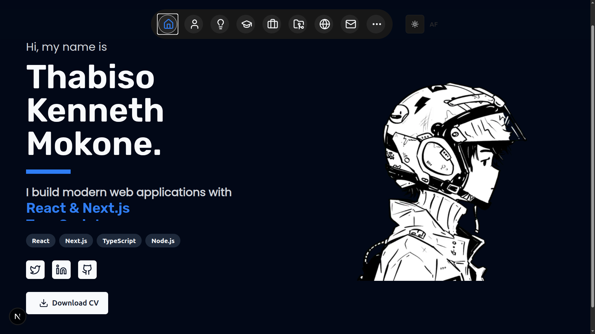

# 🌐 Thabiso Mokone --- Developer Portfolio



Welcome to my personal developer portfolio! This project showcases my
software development work, technical skills, experience, and writing.

Built with **Next.js, TypeScript, and Tailwind CSS**, the portfolio
features a responsive interface, interactive animations, an MDX-powered
blog, and persistent theme preferences.

## ✨ Features

-   **Responsive design** --- Mobile-first layouts that adapt to
    different screen sizes.
-   **Multi-language support** --- English and Afrikaans, with English
    as the default language.
-   **Dark and light themes** --- Theme preference persistence using
    local storage.
-   **MDX-powered blog** --- Technical articles and development-related
    writing.
-   **Animations** --- Interactive page transitions and component
    animations.
-   **Reusable components** --- Shared UI components and consistent
    styling.
-   **SEO support** --- Page metadata, Open Graph images, sitemap, and
    robots.txt.
-   **Project showcase** --- Selected projects with descriptions,
    technology tags, and source/demo links.

## 🛠️ Tech Stack

  Technology      Purpose
  --------------- -----------------------------------------
  Next.js 16      React framework and application routing
  React           User interface
  TypeScript      Static typing
  Tailwind CSS    Styling and responsive layouts
  Framer Motion   UI animations
  MDX             Blog content
  pnpm            Package management

## 🚀 Getting Started

### Prerequisites

-   Node.js 22 (see `.nvmrc`)
-   pnpm (preferred package manager)
-   Git

### Installation

Clone the repository:

``` bash
git clone https://github.com/mokone-september/Portfolio.git
cd Portfolio
```

Install the dependencies:

``` bash
pnpm install
```

Start the development server:

``` bash
pnpm dev
```

Open <http://localhost:3000> in your browser.

## 📜 Available Scripts

  Command             Description
  ------------------- --------------------------------------
  `pnpm dev`          Start the development server
  `pnpm type-check`   Run TypeScript checks
  `pnpm lint`         Run ESLint
  `pnpm build`        Create an optimized production build
  `pnpm start`        Start the production server

### Production Build

Run the checks and create a production build:

``` bash
pnpm type-check
pnpm lint
pnpm build
```

Start the production server:

``` bash
pnpm start
```

## 🌍 Internationalization

The portfolio supports two languages:

-   English (`/`)
-   Afrikaans (`/af`)

English is the default language. Visitors can switch languages using the
language selector.

## 📁 Project Structure

``` text
Portfolio/
├── public/                 # Static assets and images
│   └── og-image.png        # Social sharing preview
├── src/
│   ├── app/                # Next.js App Router
│   ├── components/         # Reusable UI and animation components
│   ├── content/
│   │   └── mdx/            # Blog posts
│   └── lib/                # Utilities, translations and configuration
├── .nvmrc                  # Node.js version
├── package.json            # Project dependencies and scripts
├── pnpm-lock.yaml          # Dependency lockfile
└── README.md
```

## 📝 Blog

The portfolio includes an MDX-based blog containing articles about
software development, programming, and lessons learned while building
projects.

Blog content is maintained in:

``` text
src/content/mdx/
```

## 🤝 Contributing

Suggestions, feedback, and contributions are welcome.

To contribute:

1.  Fork the repository.
2.  Create a feature branch.
3.  Install dependencies with `pnpm install`.
4.  Make your changes.
5.  Run the type-check, lint, and build commands.
6.  Submit a pull request describing your changes.

Please keep contributions consistent with the existing project structure
and coding conventions.

## 📬 Contact

-   **Email:** <mokoneseptember@gmail.com>
-   **GitHub:** [mokone-september](https://github.com/mokone-september)
-   **LinkedIn:** [Thabiso Kenneth
    Mokone](https://www.linkedin.com/in/mokone-september)
-   **Medium:** [@mokoneseptember](https://medium.com/@mokoneseptember)

------------------------------------------------------------------------

Built with ❤️ by **Thabiso Kenneth Mokone**.

Feel free to explore the repository, check out the projects, and connect
with me!
